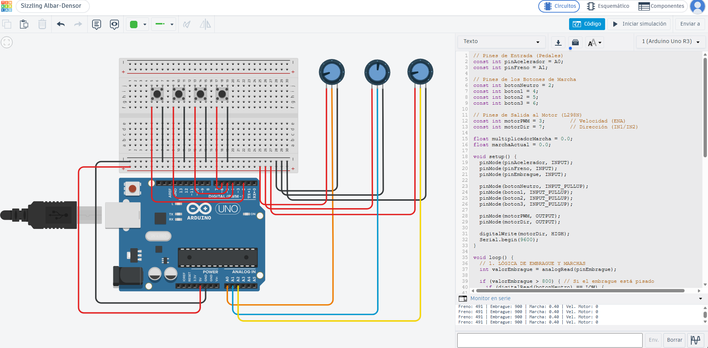
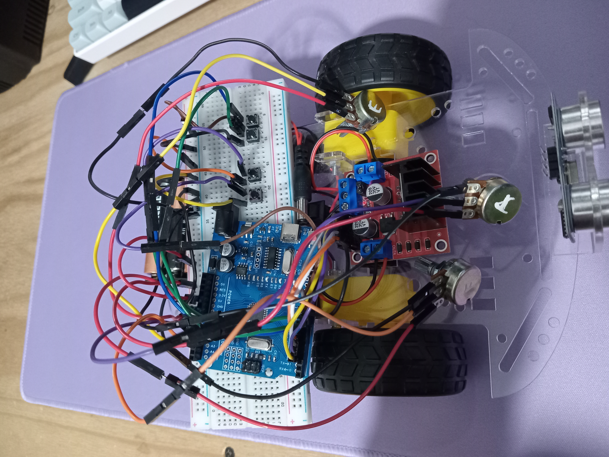

# automovil-transmision-manual-arduino
Proyecto personal de simulación de una transmisión manual mediante Arduino, con control de aceleración, freno, embrague y selección de marchas.

## Descripción del proyecto
Este proyecto personal consiste en el desarrollo de un prototipo de automóvil que simula el funcionamiento de una transmisión manual mediante Arduino.
El sistema permite controlar la aceleración, el freno, el embrague y la selección de marchas mediante potenciómetros y botones pulsadores. La velocidad de los motores varía según la marcha seleccionada y el nivel de aceleración.
El desarrollo comenzó con el diseño y la simulación del circuito en Tinkercad, donde se realizaron las primeras pruebas del código. Posteriormente, se implementó el sistema en un chasis físico de dos ruedas para comprobar su funcionamiento.

## Objetivo
Integrar conocimientos de programación y electrónica mediante la construcción de un prototipo que represente el funcionamiento de un automóvil con caja de cambios manual.

## Tecnologías y herramientas utilizadas
- Arduino Uno.
- C++.
- Tinkercad Circuits.
- Componentes electrónicos.
- Motores de corriente continua.

## Componentes del sistema
- Arduino Uno
- Motores DC
- Chasis de dos ruedas
- Controlador de motores
- 3 potenciómetros
- 4 botones pulsadores

## Funcionamiento
El sistema utiliza tres potenciómetros para representar los controles principales del automóvil:
- **Acelerador:** permite regular la aceleración.
- **Freno:** representa el control de frenado.
- **Embrague:** representa el accionamiento del embrague.
  
La selección de marchas se realiza mediante cuatro botones pulsadores:
- Neutro.
- Primera marcha.
- Segunda marcha.
- Tercera marcha.
  
La velocidad de los motores se modifica de acuerdo con la marcha seleccionada y el nivel de aceleración, permitiendo observar los cambios en el desplazamiento del prototipo.

## Desarrollo y pruebas
### 1. Simulación en Tinkercad
Primero se diseñó el circuito electrónico en Tinkercad Circuits y se desarrolló el código para comprobar el funcionamiento de las entradas y la lógica de control antes de realizar el montaje físico.

### 2. Implementación física
Una vez realizadas las pruebas de simulación, se implementó el sistema en un chasis físico con dos ruedas y motores, integrando los componentes electrónicos y el código desarrollado.

## Lógica de Programación
El sistema fue programado en C++ mediante Arduino, utilizando entradas analógicas y digitales para controlar el comportamiento del vehículo.

### Selección de marchas:
La selección de marchas se habilita cuando el valor del potenciómetro del embrague supera un umbral de 800. Cada botón pulsador representa una marcha y tiene asociado un multiplicador de velocidad:
- Neutro: 0.0
- Primera: 0.4
- Segunda: 0.7
- Tercera: 1.0

### Control de aceleración
El valor del potenciómetro del acelerador se convierte a un rango de 0 a 255. Posteriormente, se multiplica por el factor correspondiente a la marcha seleccionada para calcular la velocidad inicial de los motores.

### Control de frenado:
El potenciómetro del freno permite calcular una reducción de velocidad. Este valor se resta de la velocidad inicial y, si el resultado es negativo, se establece en cero.

### Control de motores
La velocidad final se envía a los dos motores mediante señales PWM utilizando las salidas del Arduino conectadas al controlador L298N.

### Monitor serie
Se utiliza el monitor serie para visualizar los valores del freno, embrague, marcha seleccionada y velocidad final de los motores durante las pruebas.

## Conocimientos aplicados
- Programación en C++ mediante Arduino.
- Lectura de entradas analógicas y digitales.
- Utilización de potenciómetros y botones pulsadores.
- Control de motores.
- Diseño y simulación de circuitos electrónicos.
- Integración de hardware y software.
- Pruebas y verificación del funcionamiento de un prototipo.
